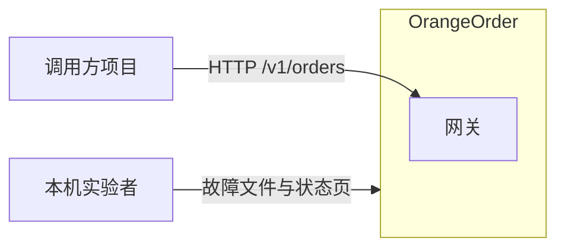
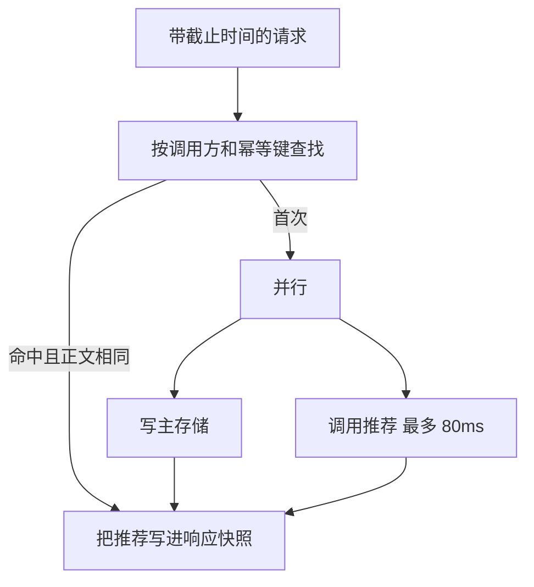
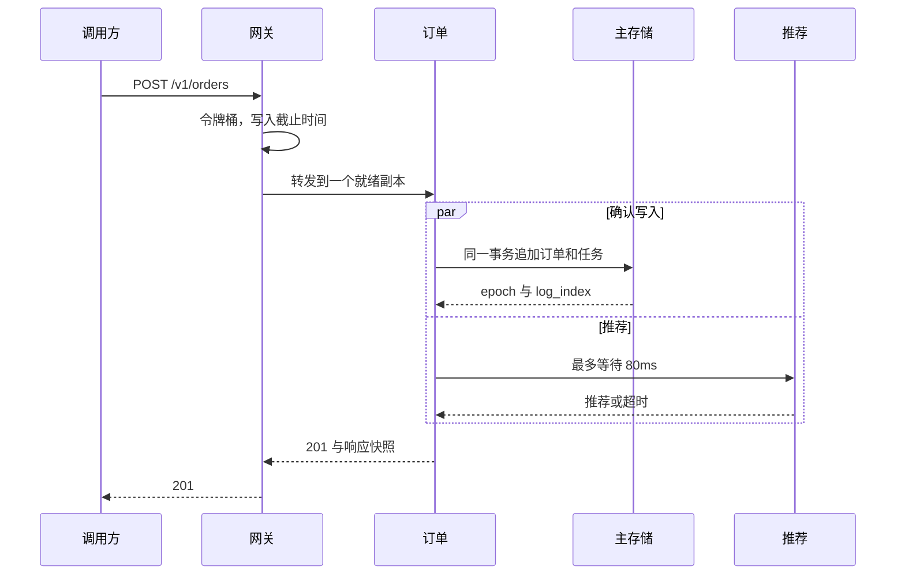
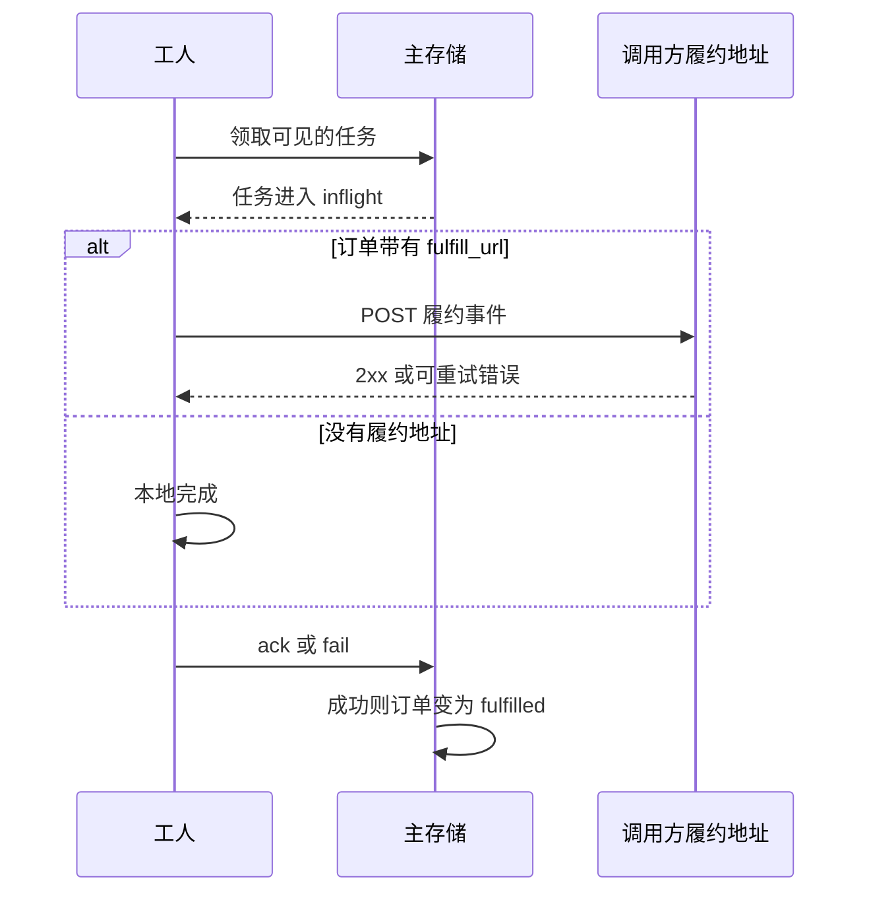
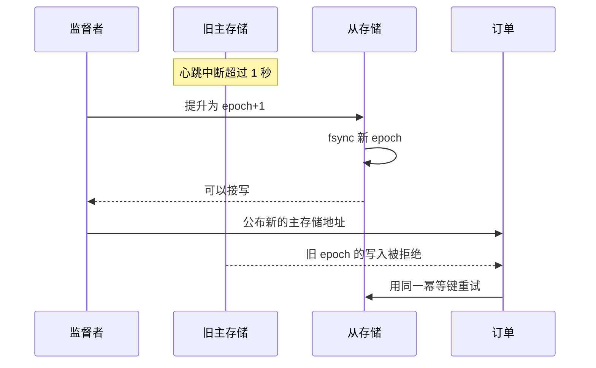
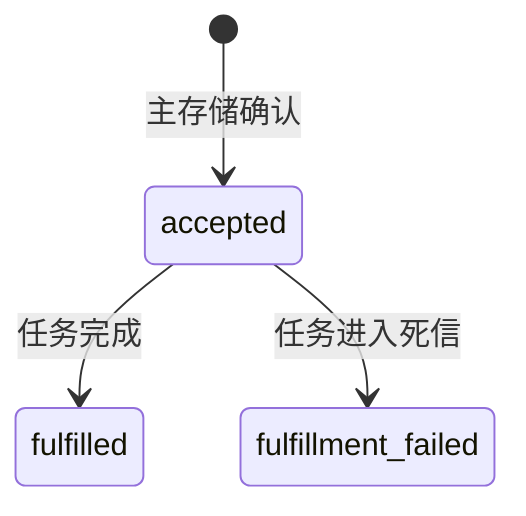
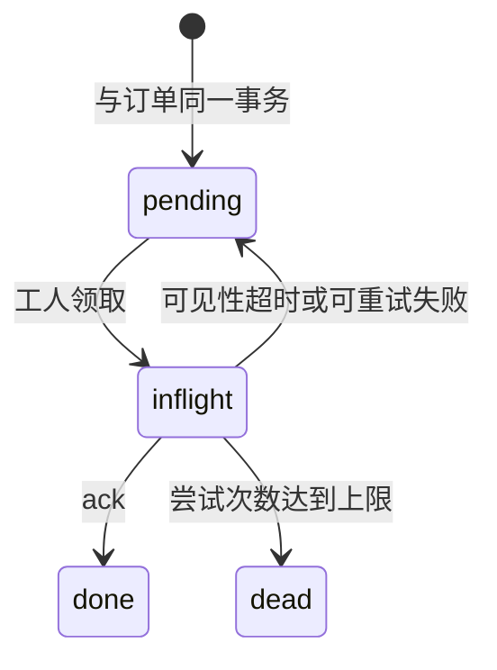
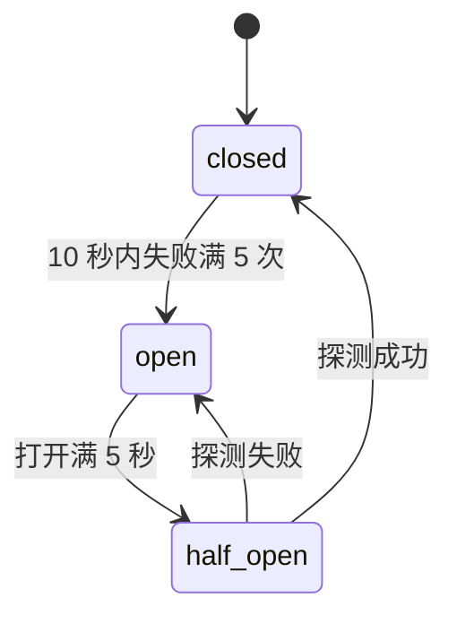

# 架构设计

英文版：[Architecture](en/architecture.md)。

| 项 | 值 |
| --- | --- |
| 状态 | 设计 0.1 已实现 |
| 版本 | 0.1 |
| 日期 | 2026-10-10 |

参数和故障细则以 [技术方案](technical-design.md) 为准。本文说明结构、路径和状态。

## 系统上下文

调用方只依赖网关。商品与价格停留在调用方。实验者通过故障文件和监督者的状态页观察系统，不走下单接口。



## 进程架构


写路径是：调用方 → 网关 → 一个就绪的订单进程 → 主存储。主存储在同一次提交里写下订单和履约任务，fsync 之后才向订单进程确认。从存储随后复制这条日志。

推荐从订单进程旁路调用，失败不影响已经准备好的提交。工人不接受调用方流量，只向主存储领取任务。

监督者连到每个进程做探活和拉起，并向订单进程公布当前主存储地址。它不参与「这次写入算不算成功」。

### 进程职责

| 进程 | 保存的状态 | 失败时谁接手 |
| --- | --- | --- |
| 网关 | 内存中的令牌桶和在途计数 | 监督者拉起；拉起期间调用方看到连接失败 |
| 订单 A / B | 内存中的熔断器 | 另一个副本；监督者重启故障副本 |
| 推荐 | 无 | 订单返回降级成功 |
| 主存储 | sqlite 中的订单、任务和复制日志 | 监督者把从存储提升为新主 |
| 从存储 | 已应用的日志投影 | 复制暂停，主存储继续接写 |
| 工人 | 无 | 任务在可见性超时后回到待领取 |
| 监督者 | 当前主地址、epoch、工人名单 | 不提升新主；现任主存储继续接写 |

订单进程是无状态的：业务记录不在它的内存或本地磁盘里。熔断计数可以丢，重启后重新累计。

## 订单进程内部



存储确认和推荐等待并行发生。存储失败则整单失败，推荐结果丢弃。存储成功而推荐未在 80ms 内返回，则 `degraded=true`，`recommendation` 为空。幂等重放直接返回第一次的快照，不再写存储，也不再问推荐。

## 下单时序



网关在转发前为请求设定绝对截止时间，默认现在起 800ms。订单进程把剩余时间再封顶为 400ms 交给主存储。超过截止时间后，订单进程不再发起新的下游调用。

## 履约时序

履约不在下单的响应里完成。调用方之后用 GET 看 `fulfillment.status`。



`fulfill_url` 只允许指向 `127.0.0.1` 的 HTTP 地址。调用方要按 `order_id` 幂等处理这次 POST，因为超时重试会再次送到。

## 主存储切换



从存储成为主存储时，只拥有它已经应用的日志。旧主上尚未复制的提交会留在旧文件里，不会自动合并。这是第一版明确接受的丢失窗口，见 [ADR 0001](adr/0001-single-leader.md)。

监督者进程自己不可用时，没有人提升新主。现任主存储继续服务。

## 状态机

订单状态由任务状态推动，调用方只看订单上的 `state` 和 `fulfillment`。





推荐熔断器在每个订单进程里单独计数：



打开期间，订单进程不再连接推荐，直接降级。

## 部署

全部进程在同一台机器、同一个工作目录中。

```text
OrangeOrder/
  python/  rust/  java/  cpp/  go/   五种实现，一次只跑一种
  runtime/faults.json                 故障开关
  runtime/data/                       两个 sqlite 文件，由存储进程自己创建
```

监督者按固定名单启动网关、两个订单进程、推荐、主存储、从存储和一个工人。工人增加时占用 8402、8403，只提供探针和指标。主存储或从存储的 sqlite 文件由该进程自己创建。复制走应用层日志，不复制数据库文件。

端口与数据路径见 [技术方案](technical-design.md)。对外只有 8080 是集成使用的端口。
