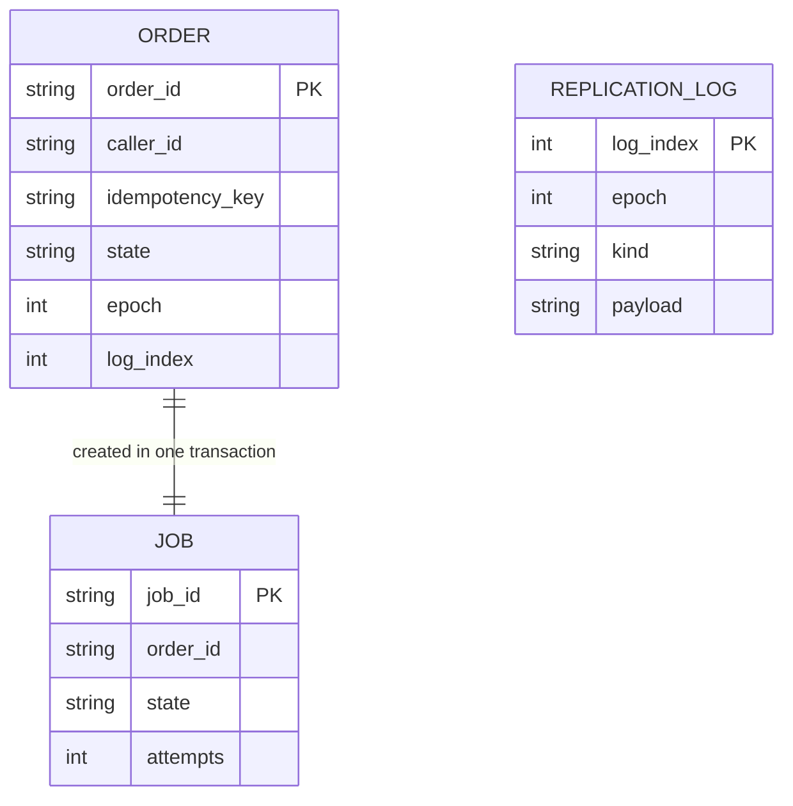

# Data model

Chinese: [数据模型](zh/data-model.md).

| Item | Value |
| --- | --- |
| Status | Design 0.1 is implemented |
| Version | 0.1 |
| Date | 2026-10-10 |

The leader store and the follower store each have one sqlite file. The leader is the source of records. The follower only applies the replication log. It does not accept writes from order processes.

Order and isolation use `epoch` and `log_index`. `created_at` is for people to read. It does not decide which write came first. A job’s `visible_after` uses the local wall clock in Unix milliseconds. A clock jump on this machine can make a job claimable slightly earlier or later.

## Relations

The idempotency record is on the order row. There is no separate table. The replication log records order and job changes by sequence number.



## Orders `orders`

| Column | Type | Meaning |
| --- | --- | --- |
| order_id | TEXT | Primary key, `ord_` plus 32 hex digits |
| caller_id | TEXT | From `X-Caller-Id` |
| idempotency_key | TEXT | From `Idempotency-Key` |
| external_ref | TEXT | Caller reference, nullable |
| sku | TEXT | Item id supplied by the caller. OrangeOrder does not interpret it |
| qty | INTEGER | 1 to 100 |
| fulfill_url | TEXT | Nullable. Only a validated local address is stored |
| state | TEXT | `accepted`, `fulfilled`, `fulfillment_failed` |
| recommendation | TEXT | Nullable |
| degraded | INTEGER | 0 or 1 |
| epoch | INTEGER | Generation when this order was confirmed |
| log_index | INTEGER | Log sequence that created this order |
| created_at | TEXT | ISO-8601 UTC, display only |
| response_json | TEXT | Snapshot of the first successful response, returned as-is on replay |

`UNIQUE(caller_id, idempotency_key)`.

The first transaction writes the snapshot with an empty `recommendation` and `degraded=1`. If recommendation returns within the budget, a later `order_snapshot` log entry replaces it with the final snapshot. `POST` returns to the caller only after the final snapshot commits. A concurrent `GET` may see the degraded snapshot first and the final result later. If the process crashes between those two commits, the order keeps the degraded snapshot, and a caller retry receives that result.

## Idempotent body

The body compared for conflicts is the canonical JSON of these four fields, keys sorted alphabetically, UTF-8:

```json
{"external_ref":"","fulfill_url":"","qty":1,"sku":"gear-1"}
```

Empty fields are empty strings. The same caller, the same idempotency key, and the same digest return the existing snapshot. A different digest is `409 idempotency_mismatch` and does not modify the existing order.

## Jobs `jobs`

| Column | Type | Meaning |
| --- | --- | --- |
| job_id | TEXT | Primary key, `job_` plus 32 hex digits |
| order_id | TEXT | The order this job belongs to |
| kind | TEXT | Version one has only `fulfill` |
| state | TEXT | `pending`, `inflight`, `done`, `dead` |
| attempts | INTEGER | Starts so far, including the current one |
| visible_after | INTEGER | Unix milliseconds. Cannot be claimed before this time |
| worker_id | TEXT | Current claimer, nullable |
| last_error | TEXT | Most recent failure, nullable |
| log_index | INTEGER | Log sequence of the latest job change |

Each order has exactly one `fulfill` job. The order row and the job row are inserted in the same sqlite transaction, and one replication log entry is appended.

Claim selects one row with `state='pending'` and `visible_after <= now`, sets it to `inflight`, increments `attempts`, sets `visible_after` to now plus 15 seconds, and writes `worker_id`. That update also enters the replication log.

## Replication log `replication_log`

| Column | Type | Meaning |
| --- | --- | --- |
| log_index | INTEGER | Primary key, increasing from 1 |
| epoch | INTEGER | Leader generation that produced this entry |
| kind | TEXT | `order_created`, `order_snapshot`, `job_claimed`, `job_reset`, `job_done`, `job_dead`, `epoch_promoted` |
| payload | TEXT | JSON of that change |
| committed_at | TEXT | ISO-8601 UTC, display only |

The leader appends the log inside the business transaction and uses `PRAGMA synchronous=FULL`. Only after the transaction commits may the order process return success upward.

The follower applies by contiguous `log_index`. A hole rejects the batch, and the follower pulls again from the last applied index.

`epoch_promoted` is written by the node about to become leader, into its own database, and fsynced, before it accepts external writes. Its `epoch` is the new generation.

## Node metadata `meta`

A single-row key-value table. It includes at least:

| key | Meaning |
| --- | --- |
| role | `leader` or `follower` |
| epoch | The generation this database believes is current |
| applied_index | Largest applied log_index |
| node_id | `store-a` or `store-b` |

Order processes do not read this table to guess the leader. The leader address comes only from what the supervisor publishes. A write to the wrong node returns `409 epoch_fenced`, and the body includes the epoch that store knows.

## Response snapshot

`response_json` matches the external GET body. See the [API](api.md). The snapshot stores the `recommendation`, `degraded`, `state`, and `fulfillment` of that moment. When the job later completes, the leader updates the order `state` and also updates `state` and `fulfillment` inside the snapshot, so GET and an idempotent replay see the latest fulfillment of the same order.

Idempotency guarantees “a second order is not created.” It does not guarantee “fulfillment fields stay at the first response.” The HTTP response of the first `POST` still returns the snapshot of that moment. Later, the caller uses GET to watch fulfillment. If the caller retries the same POST after fulfillment has finished, the replay returns the **current** snapshot, whose fulfillment status may have advanced. `order_id`, the item, the quantity, and `external_ref` do not change.
