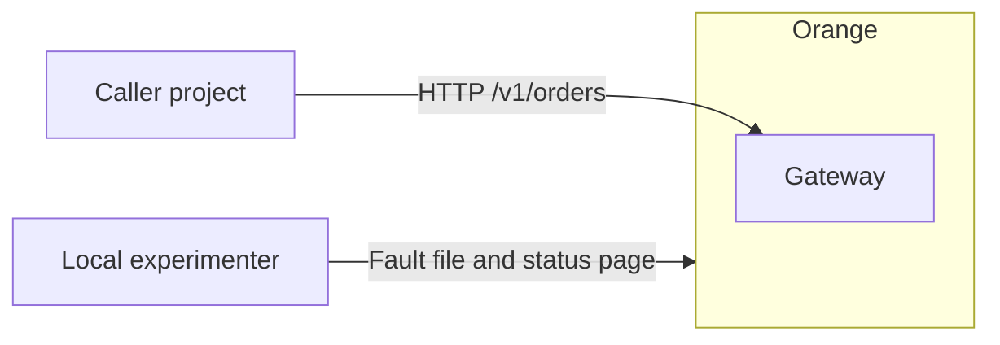
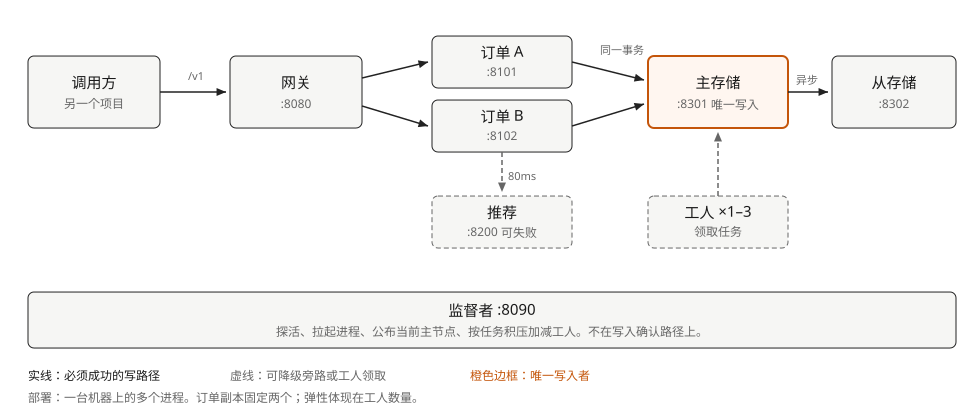
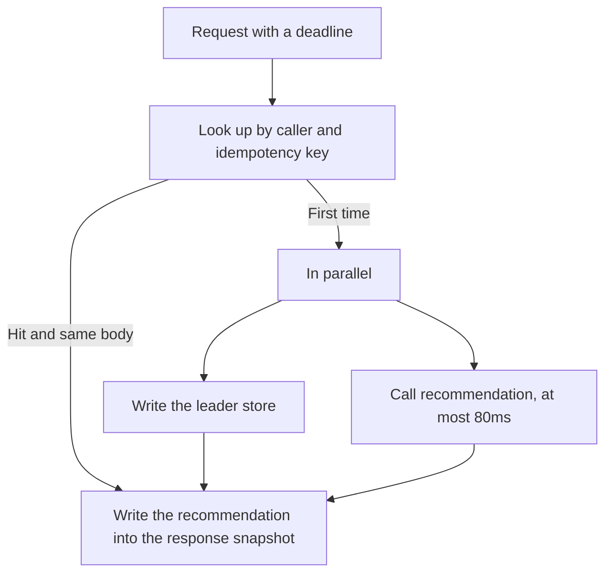
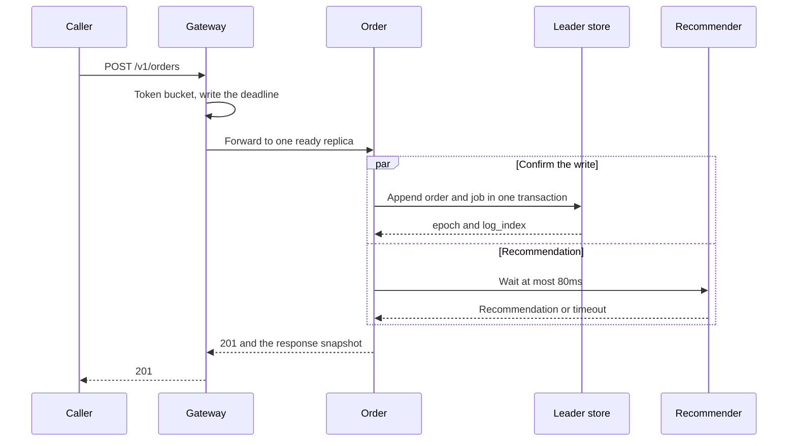
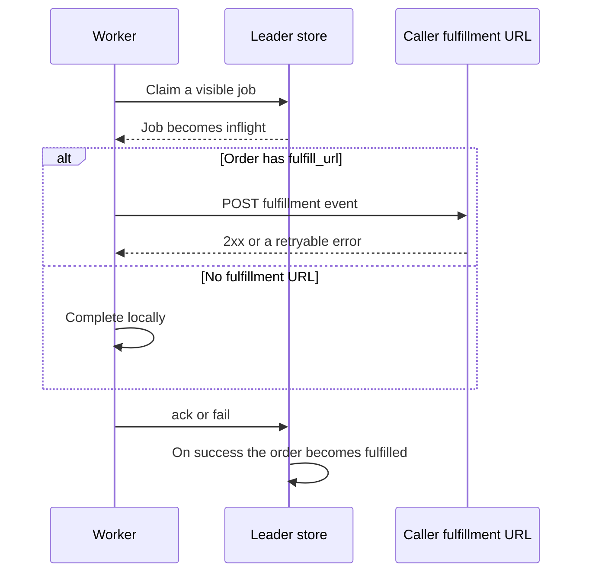
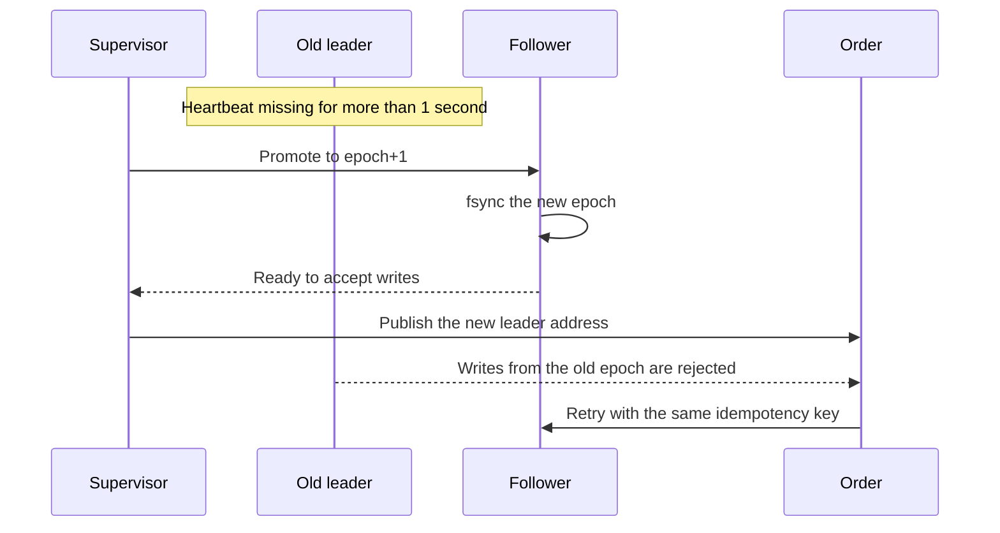
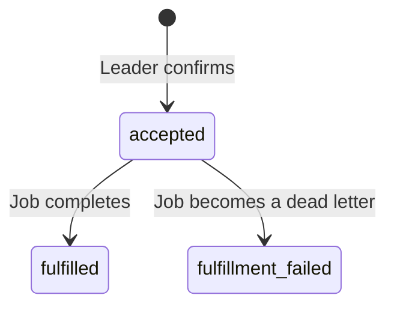
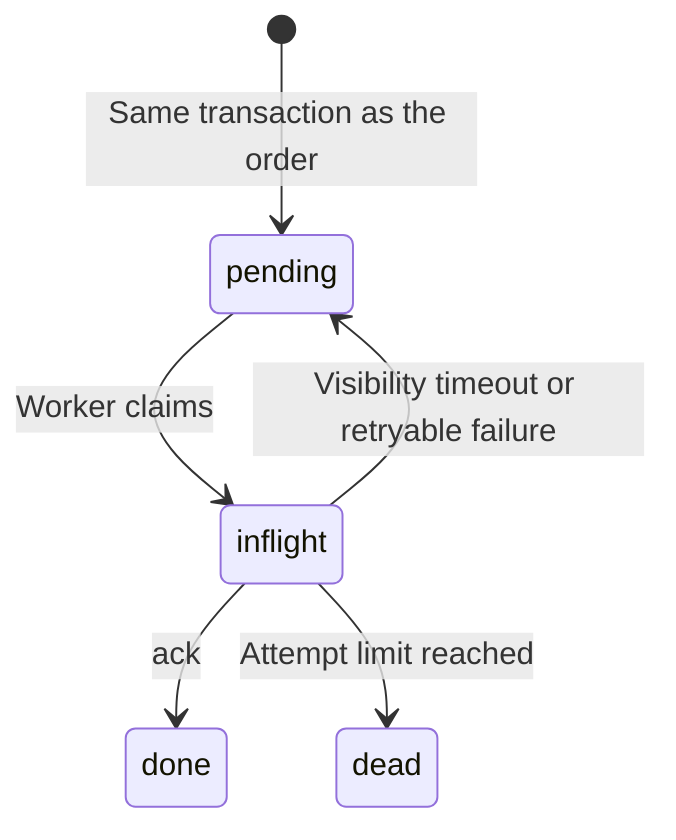
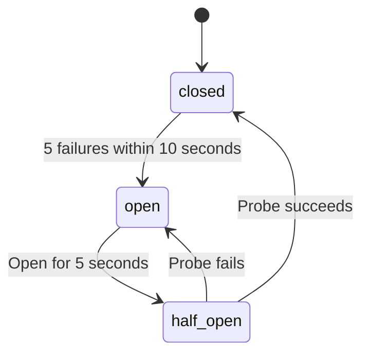

# Architecture

Chinese: [架构设计](../architecture.md).

| Item | Value |
| --- | --- |
| Status | Design 0.1 is implemented |
| Version | 0.1 |
| Date | 2026-10-10 |

Parameters and fault details follow the [technical design](technical-design.md). This document describes structure, paths, and states.

## System context

The caller depends only on the gateway. Catalog and price stay with the caller. An experimenter watches the system through the fault file and the supervisor status page, not through the order API.



## Process architecture



The write path is caller → gateway → one ready order process → leader store. The leader writes the order and the fulfillment job in one commit, and confirms to the order process only after fsync. The follower then replicates that log.

Recommendation is a side call from the order process. Its failure does not undo a commit that is already prepared. Workers do not take caller traffic. They claim jobs from the leader store.

The supervisor probes and restarts each process, and publishes the current leader address to the order processes. It does not decide whether this write succeeded.

### Process duties

| Process | State it keeps | Who takes over on failure |
| --- | --- | --- |
| Gateway | In-memory token bucket and in-flight count | The supervisor restarts it; callers see connection failure during the restart |
| Order A / B | In-memory circuit breaker | The other replica; the supervisor restarts the failed one |
| Recommender | None | The order returns a degraded success |
| Leader store | Orders, jobs, and the replication log in sqlite | The supervisor promotes the follower |
| Follower store | The applied log projection | Replication pauses; the leader keeps accepting writes |
| Worker | None | The job returns to pending after the visibility timeout |
| Supervisor | Current leader address, epoch, worker list | No promotion; the current leader keeps accepting writes |

An order process is stateless: business records are not in its memory or on its local disk. Breaker counts may be lost and start again after a restart.

## Inside an order process



Store confirmation and the recommendation wait happen in parallel. If the store fails, the whole order fails and the recommendation is discarded. If the store succeeds and recommendation does not return within 80ms, `degraded=true` and `recommendation` is empty. An idempotent replay returns the first snapshot directly, without another store write and without another recommendation call.

## Order sequence



Before forwarding, the gateway sets an absolute deadline, 800ms from now by default. The order process caps the remaining time at 400ms for the leader store. After the deadline, the order process starts no new downstream calls.

## Fulfillment sequence

Fulfillment does not finish inside the order response. The caller later GETs `fulfillment.status`.



`fulfill_url` may point only at an HTTP address on `127.0.0.1`. The caller must handle this POST idempotently by `order_id`, because a timeout retry sends it again.

## Leader switch



When the follower becomes leader, it has only the log it has already applied. Commits on the old leader that were not replicated stay in the old file and are not merged. Version one accepts that loss window. See [ADR 0001](adr/0001-single-leader.md).

If the supervisor process itself is unavailable, nobody promotes a new leader. The current leader keeps serving.

## State machines

Order state is driven by job state. The caller looks only at `state` and `fulfillment` on the order.





The recommendation breaker counts separately inside each order process:



While it is open, the order process does not connect to recommendation and degrades directly.

## Deployment

Every process is on the same machine and in the same working directory.

```text
OrangeDistributedSystem/
  python/  rust/  java/  cpp/  go/   five implementations; run one
  runtime/faults.json                 fault switches
  runtime/data/                       two sqlite files, created by the store processes
```

The supervisor starts a fixed list: gateway, two order processes, recommender, leader store, follower store, and one worker. Extra workers use 8402 and 8403 and serve only probes and metrics. Each store process creates its own sqlite file. Replication is the application log, not a copy of the database file.

Ports and data paths are in the [technical design](technical-design.md). Only 8080 is the integration port.
