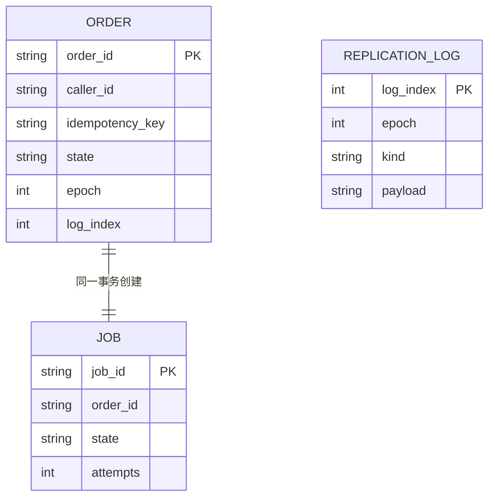

# 数据模型

英文版：[Data model](../data-model.md)。

| 项 | 值 |
| --- | --- |
| 状态 | 设计 0.1 已实现 |
| 版本 | 0.1 |
| 日期 | 2026-10-10 |

主存储和从存储各有一份 sqlite。主存储是记录来源。从存储只应用复制日志，不接受订单进程的写入。

排序和隔离用 `epoch` 与 `log_index`。`created_at` 只给人看，不参与谁先谁后。任务的 `visible_after` 使用本机墙钟的 Unix 毫秒；这台机器上的时钟跳动可能让任务稍早或稍晚可被领取。

## 关系

幂等记录就在订单行上，不单独建表。复制日志按序号记录订单和任务的变更。



## 订单 `orders`

| 列 | 类型 | 说明 |
| --- | --- | --- |
| order_id | TEXT | 主键，`ord_` 加 32 位十六进制 |
| caller_id | TEXT | 来自 `X-Caller-Id` |
| idempotency_key | TEXT | 来自 `Idempotency-Key` |
| external_ref | TEXT | 调用方单号，可空 |
| sku | TEXT | 调用方给出的商品标识，OrangeOrder 不解释 |
| qty | INTEGER | 1 到 100 |
| fulfill_url | TEXT | 可空。只保存已通过校验的本机地址 |
| state | TEXT | `accepted`、`fulfilled`、`fulfillment_failed` |
| recommendation | TEXT | 可空 |
| degraded | INTEGER | 0 或 1 |
| epoch | INTEGER | 确认这条订单时的代际 |
| log_index | INTEGER | 创建这条订单的日志序号 |
| created_at | TEXT | ISO-8601 UTC，仅供显示 |
| response_json | TEXT | 第一次成功响应的快照，重放时原样返回 |

`UNIQUE(caller_id, idempotency_key)`。

第一次事务就写入快照：`recommendation` 为空，`degraded=1`。推荐若在时限内返回，再用一条 `order_snapshot` 日志改成最终快照。`POST` 在最终快照提交之后才向调用方返回。并发的 `GET` 可能先看到降级，再看到最终结果。进程若在这两次提交之间崩溃，订单保持降级快照，调用方重试拿到的就是这份结果。

## 幂等正文

参与冲突比较的正文是下面四个字段的规范 JSON，键按字母排序，UTF-8：

```json
{"external_ref":"","fulfill_url":"","qty":1,"sku":"gear-1"}
```

空字段写成空字符串。同一调用方、同一幂等键、同一摘要：返回已有快照。摘要不同：`409 idempotency_mismatch`，不修改已有订单。

## 任务 `jobs`

| 列 | 类型 | 说明 |
| --- | --- | --- |
| job_id | TEXT | 主键，`job_` 加 32 位十六进制 |
| order_id | TEXT | 对应一笔订单 |
| kind | TEXT | 第一版只有 `fulfill` |
| state | TEXT | `pending`、`inflight`、`done`、`dead` |
| attempts | INTEGER | 已开始的次数，含当前这次 |
| visible_after | INTEGER | Unix 毫秒。到点之前不能被领取 |
| worker_id | TEXT | 当前领取者，可空 |
| last_error | TEXT | 最近一次失败原因，可空 |
| log_index | INTEGER | 最近一次任务变更的日志序号 |

每笔订单恰好一个 `fulfill` 任务。订单行和任务行在同一个 sqlite 事务里插入，并追加一条复制日志。

领取任务时：选择 `state='pending'` 且 `visible_after <= now` 的一行，改为 `inflight`，`attempts` 加 1，`visible_after` 设为现在加 15 秒，写下 `worker_id`。这一更新也进入复制日志。

## 复制日志 `replication_log`

| 列 | 类型 | 说明 |
| --- | --- | --- |
| log_index | INTEGER | 主键，从 1 单调增加 |
| epoch | INTEGER | 产生这条日志的主存储代际 |
| kind | TEXT | `order_created`、`order_snapshot`、`job_claimed`、`job_reset`、`job_done`、`job_dead`、`epoch_promoted` |
| payload | TEXT | 该变更的 JSON |
| committed_at | TEXT | ISO-8601 UTC，仅供显示 |

主存储在业务事务里追加日志，并使用 `PRAGMA synchronous=FULL`。事务提交成功之后，才允许订单进程向上返回成功。

从存储按 `log_index` 连续应用。中间有空洞则拒绝这批数据，改用「从上次已应用序号继续拉」补齐。

`epoch_promoted` 由即将上任的节点在对外接写之前写入自己的库，并 fsync。它的 `epoch` 是新代际。

## 节点元数据 `meta`

单行键值，至少包括：

| key | 含义 |
| --- | --- |
| role | `leader` 或 `follower` |
| epoch | 本库相信的当前代际 |
| applied_index | 已应用的最大 log_index |
| node_id | `store-a` 或 `store-b` |

订单进程不读取这份表来猜谁是主。主存储地址只来自监督者公布的结果；写到错误节点时，存储返回 `409 epoch_fenced`，正文带上它知道的 epoch。

## 响应快照

`response_json` 与对外 GET 的主体相同，见 [接口说明](api.md)。快照里保存当时的 `recommendation`、`degraded`、`state` 和 `fulfillment`。任务后来完成时，主存储更新订单 `state`，同时更新快照里的 `state` 与 `fulfillment`，这样 GET 和幂等重放看到同一笔订单的最新履约状态。

幂等保证的是「不会创建第二笔订单」，不是「履约字段永远停在第一次响应」。第一次 `POST` 的 HTTP 响应仍返回当时的快照；之后调用方用 GET 看履约进展。若调用方把同一次 POST 重试到履约完成之后，重放返回的是**当前**快照，其中履约状态可能已经前进。`order_id`、商品、数量和 `external_ref` 不变。
